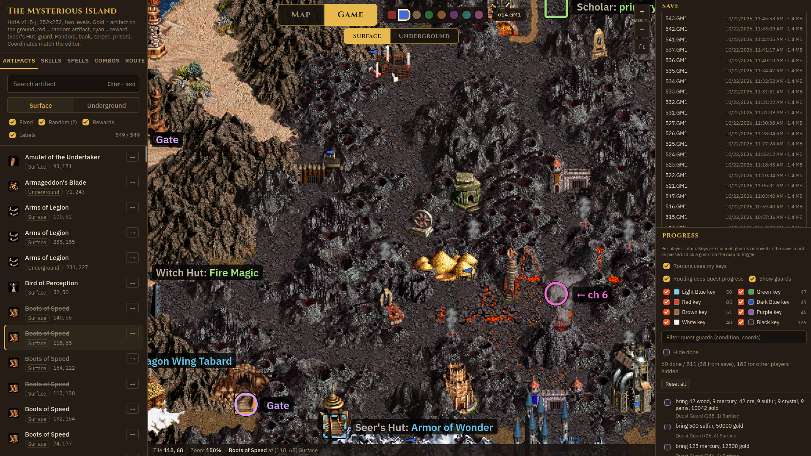
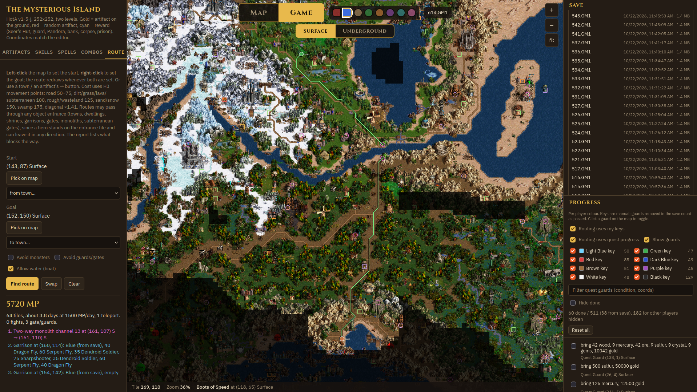
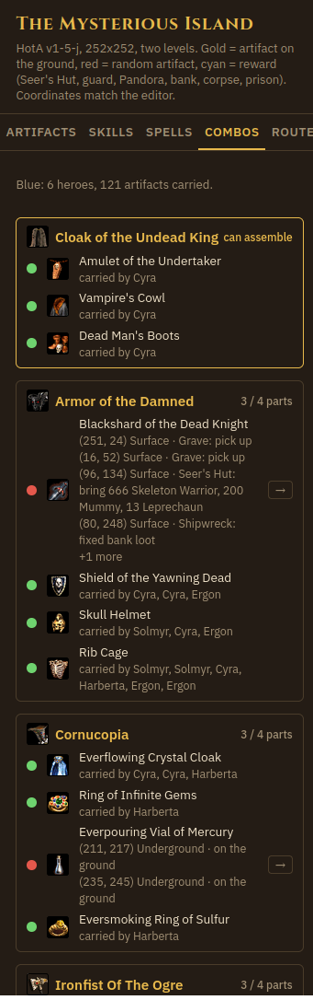
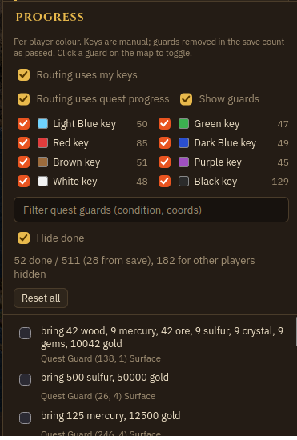
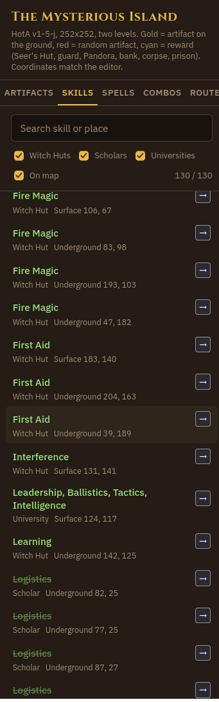

# Mysterious Island Atlas

An interactive companion for the Heroes of Might and Magic III: Horn of the Abyss map
**The Mysterious Island** (v1-5-j, 252x252, two levels). It renders the map with the
game's own sprites, knows where every artifact, quest and portal is, finds the cheapest
route between two points, and reads your savegames to show the world as your player
currently sees it.

Everything runs on your machine. No account, no upload, no internet needed.



## Download and run

Grab the latest build from the
[Releases page](https://github.com/michalkasarda/Heroes3HotaCompanion/releases):

| Platform | File |
|---|---|
| Windows 10/11 (64-bit) | `MysteriousIslandAtlas-<version>-win-x64.exe` (installer) |
| Linux, any distro | `MysteriousIslandAtlas-<version>-linux-x86_64.AppImage` (make executable, run) |
| Debian / Ubuntu | `MysteriousIslandAtlas-<version>-linux-amd64.deb` |

The executable is not signed, so Windows SmartScreen warns on first start; choose
"More info" and "Run anyway".

## Saves folder

The app needs the Heroes 3 `Games` folder, the one that holds your `.GM1` files. On start it
looks in the usual places:

- Windows: `C:\Games\Heroes 3 HotA\Games`, the GOG and Steam HD install folders, `C:\Heroes3\Games`
- Linux: Bottles and Wine prefixes, VCMI saves

If none matches, the Save panel shows **Choose folder...** (also under **File > Choose saves
folder...**). Pick the `Games` folder; subfolders such as `- The Mysterious Island -` are scanned
too. The choice is remembered. Click **Refresh list** after saving in the game, or
**Load newest** to jump to the latest autosave.

## What you get

### Map mode
The whole map as placed by the map maker, surface and underground, drawn from the original
sprites. Pan by dragging, zoom with the wheel, switch level with the buttons on top.

- **Artifacts**: all 290 artifact spots with icons. Random spots show their class (treasure,
  minor, major, relic). 259 further artifact sources are listed as rewards: Seer's Hut quests
  with their condition, Pandora's Boxes, creature banks with fixed loot, corpses, graves,
  prisons with the hero's equipment, and stacks that drop an artifact when killed.
- **Skills** and **Spells**: every Witch Hut, Scholar, University, Seafaring Academy and Shrine
  with what it teaches.
- **Portals**: monolith channels, subterranean gate pairs and whirlpools. Click one to see
  its exits drawn on the map.
- **Right mouse button, hold**: an in-game style box for anything under the cursor. Owner and
  flag colour, creature stack and count, artifact effect, Seer's Hut quest and reward, guard
  condition, resource amount, and a one-line description of what the building does.

### Route


Left-click the map for the start, right-click for the goal (or pick a town, or use the arrow
next to any list entry). The planner uses real Heroes 3 movement costs: roads 50 to 75 points,
dirt and grass 100, rough 125, sand and snow 150, swamp 175, diagonals x1.41, plus 2500 points
for every embark or disembark. It walks through towns, dwellings, garrisons, gates, monoliths,
subterranean gates and whirlpools the way a hero can, and reports what is in the way: stacks to
fight, border guards and which Keymaster's Tent has the key, quest guards and their condition,
garrisons with owner and army, teleports taken, sea crossings. Options: avoid monsters, avoid
guards and gates, allow water.

### Game mode (savegame import)
Pick a save in the Save panel and the map switches to Game mode:

- Fog of war of your colour. Under the fog the map shows its original state, so you only see
  what your player would know.
- Taken artifacts, opened chests and boxes, killed stacks and passed guards disappear from the
  map. Random artifacts, dwellings, monsters and towns show what they became.
- Towns, mines, dwellings, garrisons and lighthouses fly their owner's flag. Every hero stands
  where the save puts them, with name and colour.
- Seer's Huts you have completed are marked done, random artifacts you have seen show the real
  item, and routing ignores guards you already passed.
- The player colour is chosen with the dots next to the Map / Game switch.

### Combos


Reads the equipment and backpacks of all your heroes, including those inside towns, and checks
the 16 combination artifacts (the 12 classic ones plus Golden Goose, Pendant of Reflection,
Diplomat's Cloak and Ironfist of the Ogre). Parts you hold are green with the carrier's name;
missing parts list every source on the map, ground spots as well as quests and rewards, with a
menu to zoom to each one or route there.

### Progress


Per player colour: tick the keys you hold and the quest guards you have passed. Quest guards
meant for other colours are hidden, and in Game mode the guards already removed in your save
count as passed automatically. Routing treats locked guards as walls.



## Limits

- Keys are not stored in the savegame in any form I could find, so tick them yourself.
- Creature stack sizes are the ones placed in the map editor; the save does not expose current
  numbers.
- Hero sprites all use the knight model. A handful of HotA 1.8 decorations have no sprite.
- Built for this one map and HotA 1.8 saves (map format 10). See below for other maps.

## Other maps

The app is baked for The Mysterious Island: terrain tiles, the sprite atlas, object lists,
quests and the anchors the save reader needs are all generated from that map file. To get
another HotA map, the generator pipeline in `src/` has to be run on its `.h3m`
(`h3m.py` parse, `tiles.py` terrain, `build_assets.py` atlas, `rewards.py`, `nav.py`,
`oinfo.py`), then the Electron app repacked. Classic SoD maps would need small parser changes;
HotA versions other than 1.8 may differ in the save layout.

## Building from source

```
cd electron
npm install
npm run dist      # copies ../app, builds release/ (NSIS exe, AppImage, deb)
```

Requires Node 20; building the Windows installer on Linux needs wine. Pushing a tag `v*`
runs the GitHub Actions workflow, which builds on Windows and Linux and attaches the
installers to the release.

Layout: `app/` is the generated web app (page, terrain tiles, sprite atlas, data),
`src/` the Python generator pipeline (needs a HotA install for the game data files, path in
`src/lod.py`), `electron/` the desktop wrapper, `serve.py` a tiny local server to run the
web app without Electron.
